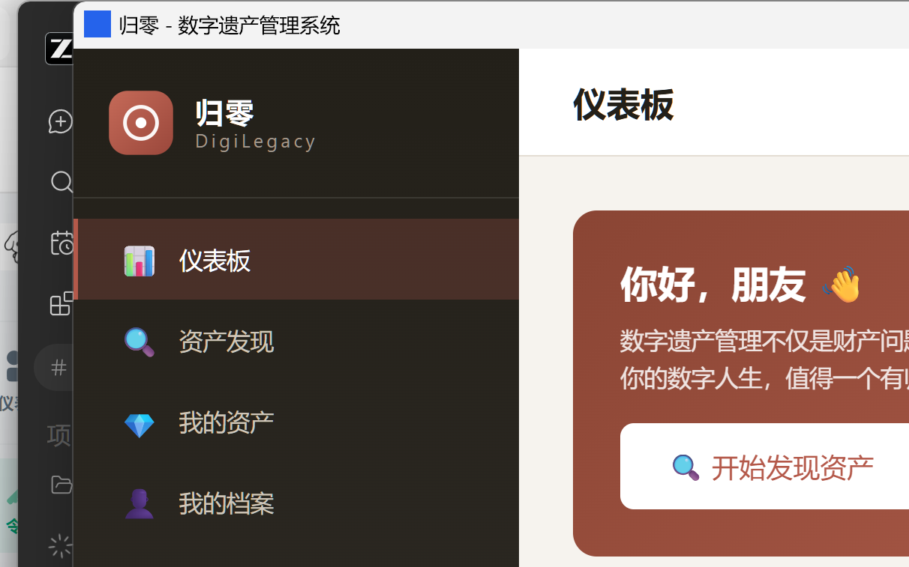
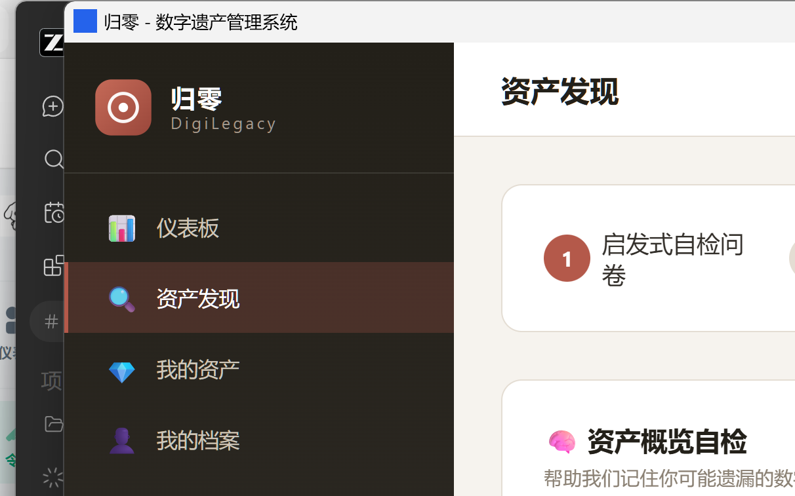
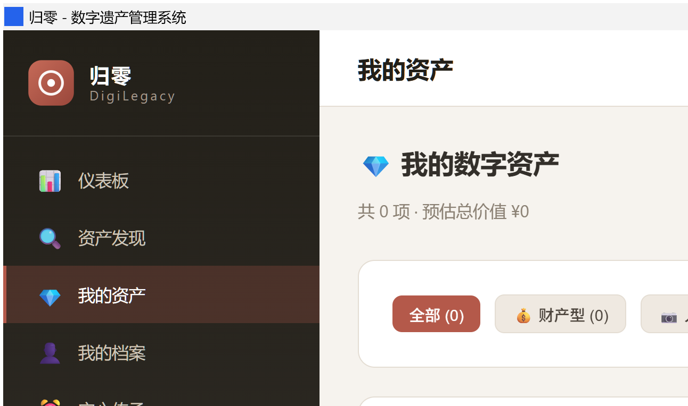
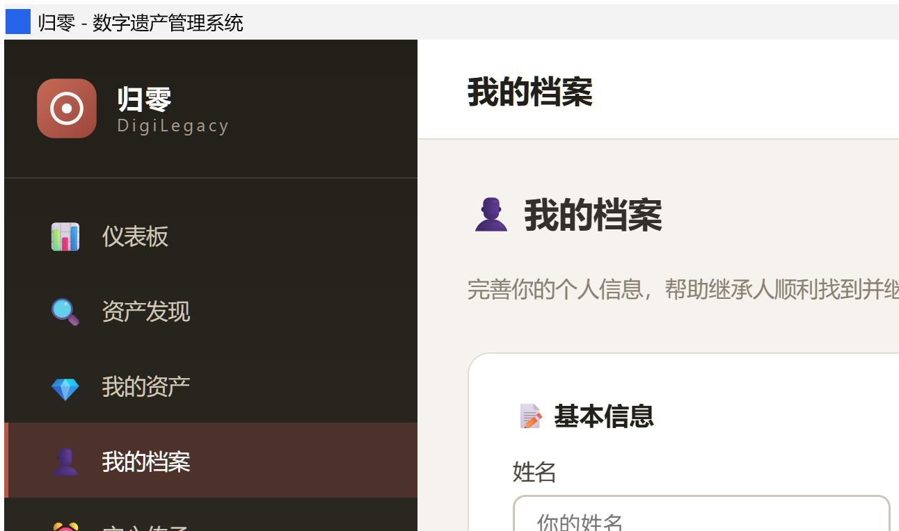
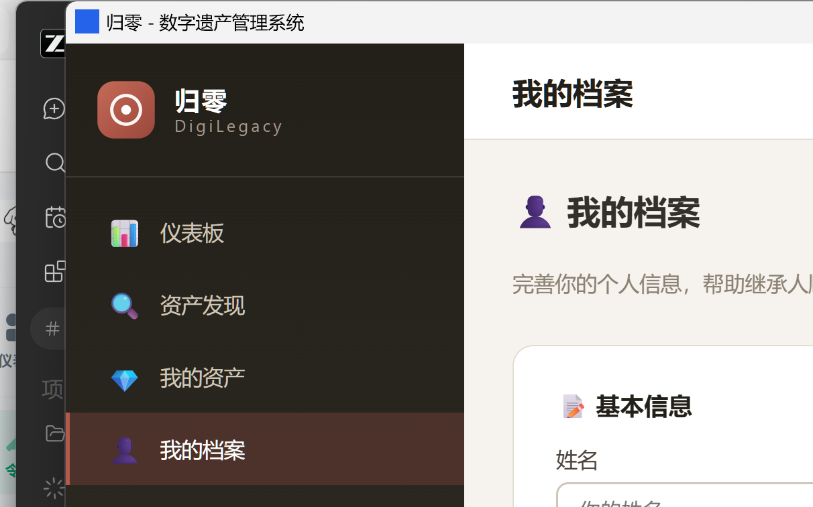
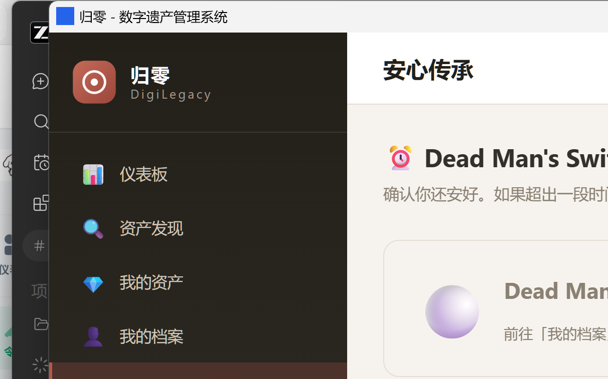
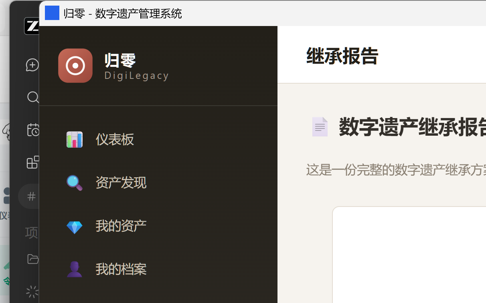
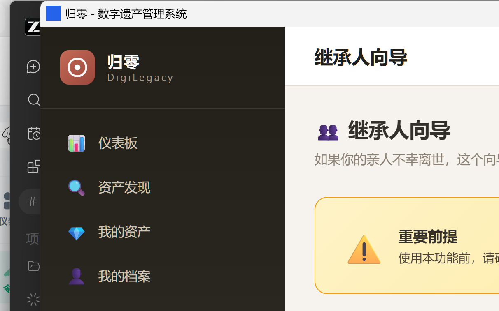

# 归零 DigiLegacy · 数字遗产管理系统

> 广东省「挑战杯」大学生创业计划竞赛项目 · 赛道：社会治理和公共服务
>
> 数字有数，归处有路。

一款本地优先、隐私优先的桌面端数字遗产规划工具。生前帮助用户**发现、登记、规划处置**自己的数字资产；身后帮助继承人**有序、合规地继承**。

---

## 一、项目定位

| 项 | 内容 |
|---|---|
| 中文名 | 归零（"归"=回归归属，"零"=归零处理） |
| 英文名 | DigiLegacy |
| 形态 | 桌面应用（Tauri 2 + Vue 3 + TypeScript + SQLite） |
| 核心主张 | **即便开发者也无法读取用户的数字遗产数据**——无服务器、无云端同步，数据仅存本地 |

## 二、界面截图

| | |
|---|---|
|  |  |
| *仪表板* | *资产发现* |
|  |  |
| *我的资产* | *我的档案* |
|  |  |
| *安心传承（DMS）* | *继承报告* |
|  |  |
| *继承人向导* | *法律模板* |

## 三、使用指南

### 场景 A：资产持有人（生前规划）

1. **资产发现**：回答自检问卷，应用从内置的 152 个平台库（16 个分类）中引导式发现你可能持有的数字资产，并自动排除已登记项
2. **我的资产**：确认发现结果、补登遗漏；每项资产自动归入财产型 / 人格型 / 混合型三维分类
3. **处置意愿**：为每项资产选择处置方式——指定继承、变现分配、纪念化、授权查阅、彻底删除、捐赠或不做处理
4. **我的档案**：完善本人与继承人基础信息，作为报告与文书的数据来源
5. **安心传承（DMS）**：开启定期签到（顶部按钮一键检查）；到期未确认将沿三级确认链逐级通知
6. **继承报告**：一键生成汇总报告，导出 HTML 报告与继承工具包 ZIP（报告 / 清单 / 统计三件套）
7. **法律模板**：下载遗嘱、继承声明、授权委托等 6 类文书模板，配合线下公证使用

### 场景 B：继承人（身后执行）

1. **继承人向导**：按平台查询办理流程、变现 / 过户路径卡与常见困难应对方案
2. **继承工具包**：使用持有人导出的 ZIP 与法律模板，按清单逐平台办理

### 数据安全

所有数据仅存储在本机 SQLite 数据库中，应用无服务器、无遥测；卸载应用即完全删除数据。

## 四、功能模块

| # | 模块 | 说明 | 状态 |
|---|---|---|---|
| 1 | 数字资产发现引擎 | 基于内置 152 个中国主流平台库（16 个分类），启发式自检问卷 + 引导式发现，自动去重已登记平台 | MVP |
| 2 | 资产分类与登记 | 财产型 / 人格型 / 混合型三维自动归类，用户确认后入库 | MVP |
| 3 | 处置意愿设定 | 指定继承、变现分配、纪念化、授权查阅、彻底删除、捐赠、不做处理 | MVP |
| 4 | 继承报告生成 | 汇总资产清单与处置方案，导出 HTML 报告 + 继承工具包 ZIP（报告/清单/统计三件套） | MVP |
| 5 | 安心传承（DMS） | Dead Man's Switch 三级确认链 + 定期签到，到期通知已接通：本地发件箱（离线兜底）+ 可选 SMTP 投递 | MVP |
| 6 | 继承人向导 | 面向继承人的平台办理导航、变现/过户路径卡、常见困难解决方案 | MVP |
| 7 | 法律模板库 | 6 类法律文书模板（遗嘱/继承声明/授权委托/宣誓书/申请/协议），预览与下载 | MVP |

## 五、技术架构

```
Vue 3 + TypeScript + Pinia + Vue Router      前端
        │  Tauri invoke (19 个 command)
Tauri 2 (Rust)                              桌面壳层
        │
rusqlite (SQLite, bundled)                  本地存储
aes-gcm / rand / base64                     加密基础设施
```

### 目录结构

```
挑战杯/
├── .gitignore
├── 数字遗产/
│   └── digilegacy/                  应用本体
│       ├── src/                     Vue 前端
│       │   ├── views/               9 个页面
│       │   ├── stores/              Pinia 状态
│       │   ├── types/               类型定义
│       │   └── assets/main.css      设计令牌与全局样式
│       ├── src-tauri/               Rust 后端
│       │   ├── src/
│       │   │   ├── platform_data.rs 152 平台 / 16 分类政策数据库
│       │   │   ├── db.rs            SQLite schema 与全部查询
│       │   │   ├── commands.rs      19 个 Tauri command
│       │   │   ├── crypto.rs        AES-256-GCM 基础设施
│       │   │   └── models.rs        数据模型
│       │   └── capabilities/        权限白名单
│       ├── package.json
│       └── vite.config.ts
└── LICENSE
```

## 六、开发

### 环境要求

- Node.js ≥ 18
- Rust 工具链（stable）
- Tauri 2 平台依赖（Windows 需 WebView2 + MSVC Build Tools）

### 常用命令

```bash
cd 数字遗产/digilegacy

npm install

npm run dev            # 仅前端开发服务器（http://localhost:1420）
npm run tauri:dev      # 完整桌面应用开发模式
npm run build          # 类型检查 + 前端生产构建
npm run tauri:build    # 打包桌面安装包
```

### 验证状态

- `npx vue-tsc --noEmit` 通过
- `npm run build` 通过（68 modules，含类型检查）
- `cargo check` 通过
- `cargo test` 通过（17 / 17）

## 七、数据存储

数据库位于系统应用数据目录下的 `digilegacy.db`（Windows：`%APPDATA%\com.digilegacy.app`），包含 5 张表：

`platforms`、`digital_assets`、`user_profile`、`check_in_log`、`dms_config`

首次启动时自动建表并写入 152 个平台的政策数据。

## 八、隐私设计

1. 无服务器、无遥测、无云端同步
2. 应用层权限白名单收敛在 `src-tauri/capabilities/default.json`
3. `crypto.rs` 已实现 AES-256-GCM 加密基础设施；MVP 阶段数据库依赖操作系统文件级访问控制，字段级加密为下一阶段目标

## 九、许可

MIT，见 [LICENSE](LICENSE)。