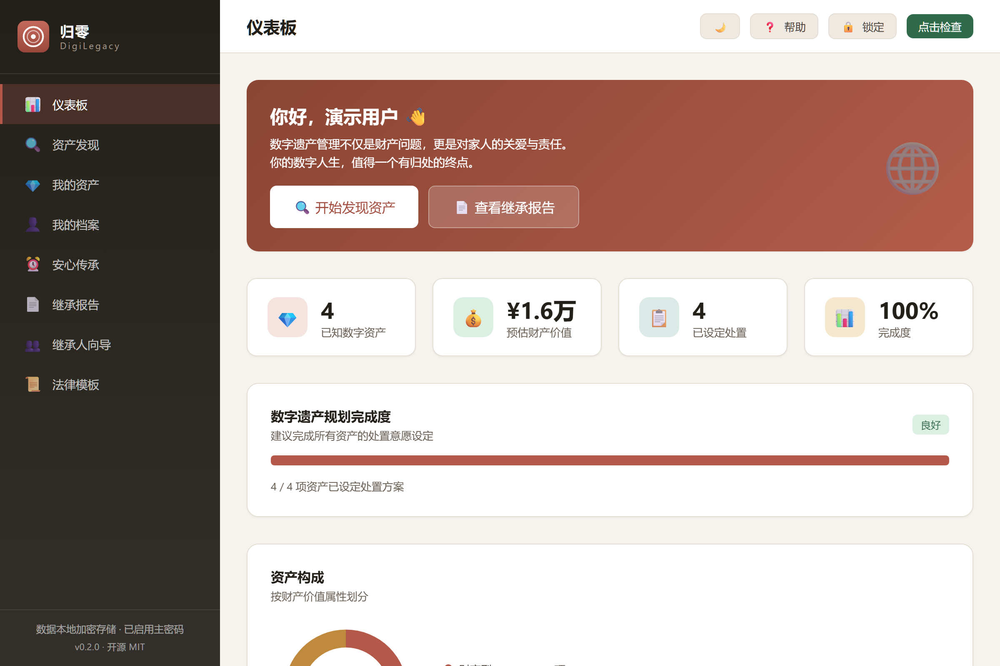
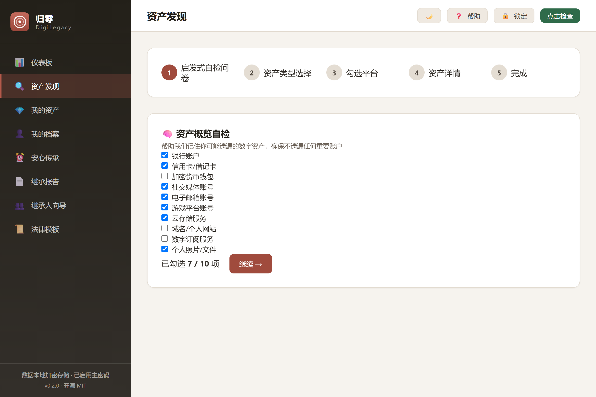
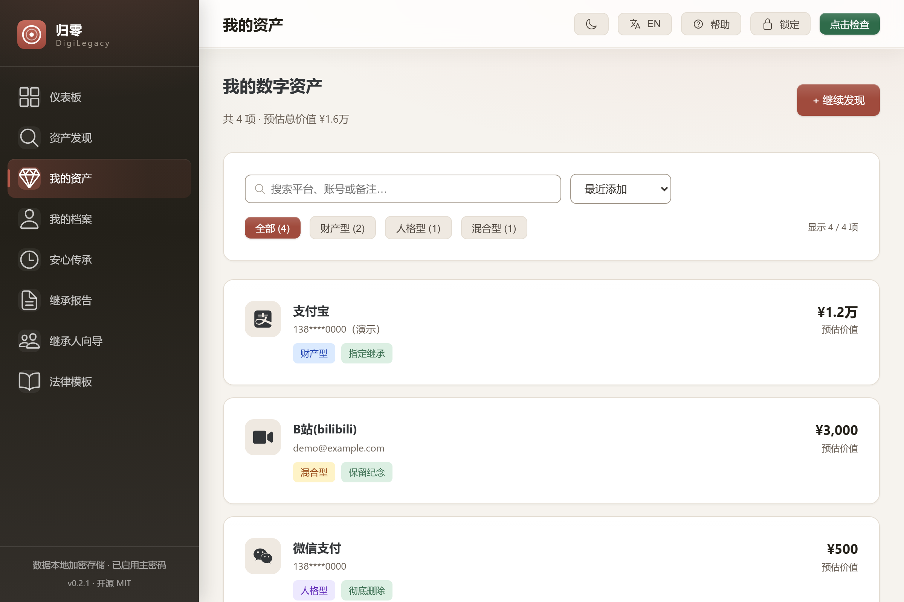
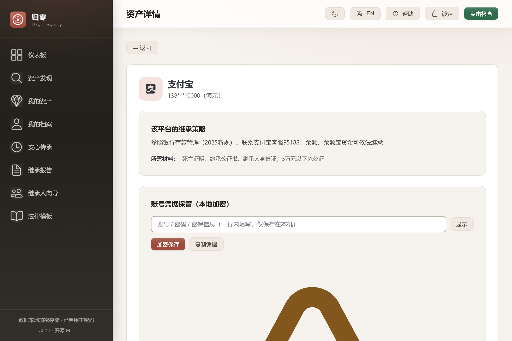
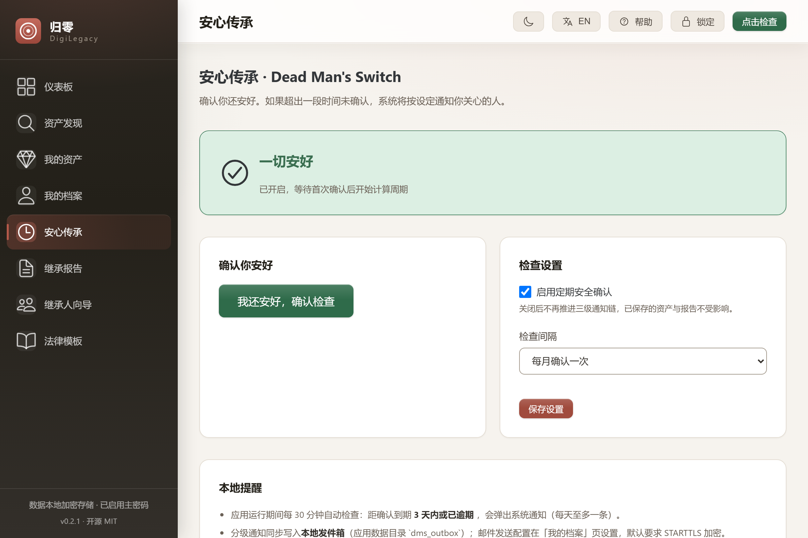
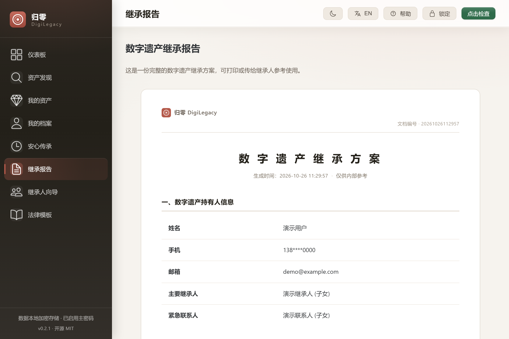
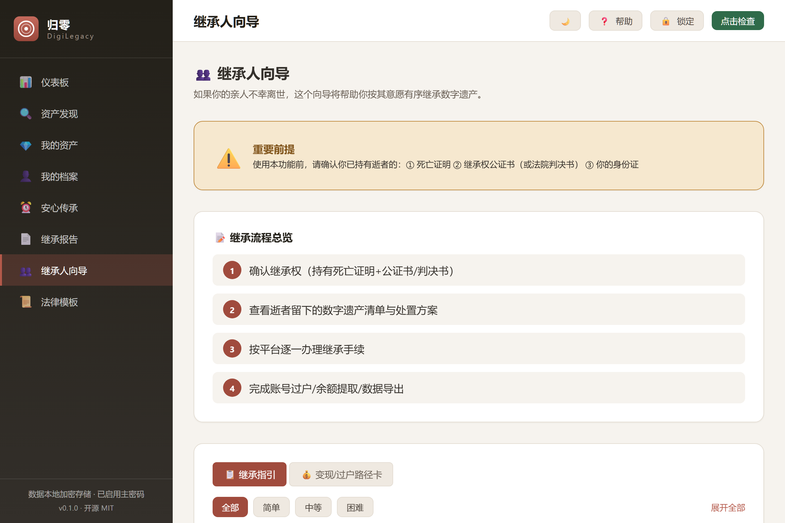
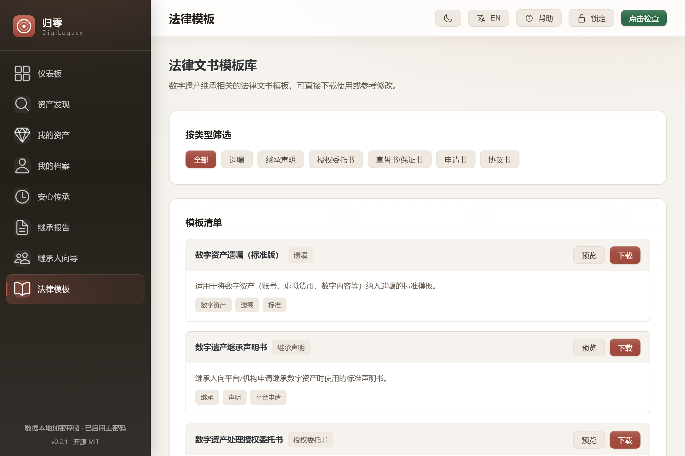
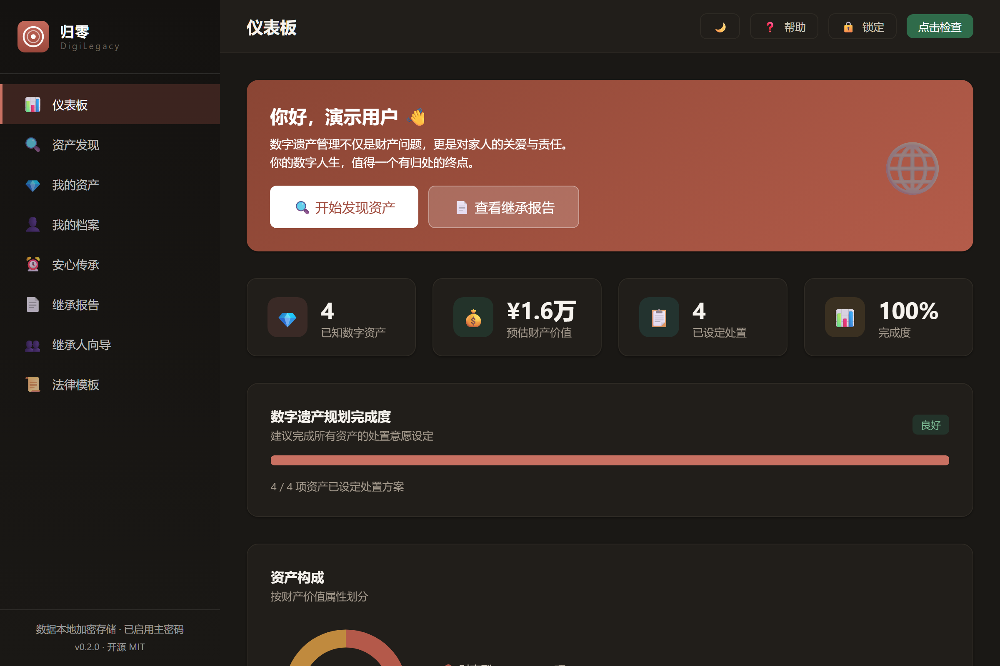

<div align="center">



<h1>DigiLegacy 归零</h1>

<p><strong>Plan your digital legacy. Leave your family a toolkit, not a puzzle.</strong></p>

<p>
  <a href="https://github.com/badhope/digilegacy/actions/workflows/ci.yml"></a>
  
  
  
  
  
</p>

<p>
  <a href="https://badhope.github.io/digilegacy/"><strong>Website</strong></a> ·
  <a href="https://badhope.github.io/digilegacy/zh/">中文官网</a> ·
  <a href="https://badhope.github.io/digilegacy/demo/"><strong>Live demo</strong></a> ·
  <a href="https://github.com/badhope/digilegacy/releases"><strong>Download</strong></a>
</p>

<p><a href="README.zh-CN.md">简体中文</a> · <strong>English</strong></p>

</div>

---

## The whole chain, in one app

Most tools solve one slice: Google and Apple only cover their own accounts, password managers hand over passwords, will services never touch the accounts. DigiLegacy covers the full path — **discovery → registration → planning → documents → trigger → execution** — in a single local database.

| | |
|---|---|
| **152** platforms in the built-in inheritance policy database, 16 categories | **60** IPC commands across a Rust core and a Vue frontend |
| **AES-256-GCM** field-level encryption, PBKDF2-SHA256 at 600k iterations | **0** servers, **0** telemetry, **0** cloud calls |

## A guided tour

<table>
<tr>
<td width="50%"><br><sub><b>Discovery</b> — a self-check questionnaire that surfaces accounts you forgot</sub></td>
<td width="50%"><br><sub><b>Your assets</b> — search, four sort orders, disposal status at a glance</sub></td>
</tr>
<tr>
<td><br><sub><b>Asset detail</b> — platform policy, disposal wish, encrypted credential vault</sub></td>
<td><br><sub><b>Dead man's switch</b> — three-stage chain: you → emergency contact → executor</sub></td>
</tr>
<tr>
<td><br><sub><b>Inheritance report</b> — print-ready document plus a ZIP toolkit</sub></td>
<td><br><sub><b>Heir guide</b> — per-platform procedure, documents and transfer path</sub></td>
</tr>
<tr>
<td><br><sub><b>Legal templates</b> — six categories, ready to fill in</sub></td>
<td><br><sub><b>Dark mode</b> — token-driven, WCAG AA contrast</sub></td>
</tr>
</table>

**[▶ Watch the 32-second walkthrough](docs/media/demo-walkthrough.mp4)** — the entire flow, no install.

## What you get

| | | |
|---|---|---|
| 🔍 **Discovery** | 152-platform policy library, guided questionnaire, de-duplication | |
| 🗂 **Registration** | Property / personality / mixed classification, per-asset detail | |
| 📝 **Disposal planning** | Inherit · liquidate · memorialize · authorize · delete · donate | |
| 📄 **Report & toolkit** | Print-ready HTML + ZIP (report, asset list, summary, instructions) | |
| ⏰ **Dead man's switch** | Three-stage confirmation chain, tray residency, optional zero-content heartbeat | |
| 👥 **Heir guidance** | Per-platform documents, procedure, transfer path, risk warnings | |
| 🔐 **Encrypted vault** | AES-256-GCM, idle auto-lock, one-time recovery key, encrypted backup | |
| 🎨 **Two themes** | Light and dark from the same design tokens, reduced-motion aware | |
| 🔎 **Search & charts** | Full-text search, sorting, ECharts composition donut | |
| 🧪 **Live demo** | Full UI in the browser on mock data — click before you install | |

## Built like a product

| Check | Result |
|---|---|
| Rust tests | **118 passing**, 1 ignored (`cargo test --locked`; 158 declared incl. 1 Unix-only) |
| Frontend unit tests | **381 passing** across 31 files |
| End-to-end tests | **76 passing** in real Chromium |
| Coverage | **85.4% statements**, 86.9% lines — thresholds enforced in CI |
| Type safety | `vue-tsc --noEmit` clean, Rust `clippy -D warnings` clean |
| Supply chain | `cargo audit` and `npm audit`: 0 vulnerabilities |
| CI | 5 jobs — frontend, E2E, Rust, heartbeat server, Windows installer build |
| Release | Signed build pipeline with SHA-256 checksums, verified after publish |

**Production hygiene:** the demo backend is compiled out of the installer (CI asserts no `mock-*` chunk), the schema is versioned with `PRAGMA user_version`, command inputs are capped and validated at the IPC boundary, backups carry heartbeat settings, policy patches, the recovery seal, heirs, SMTP, custody locations and assistant config (v4), backup, report, toolkit and SMTP-credential files are written owner-only, and importing a backup writes a pre-import snapshot and merges by default.

## Get started

**Windows 10/11 · ~3.5 MB · no account, no sign-up, no network**

```bash
# Download from Releases, then run the installer.
# Your data lives in: %APPDATA%\com.digilegacy.app\digilegacy.db
```

[⬇ Download the installer](https://github.com/badhope/digilegacy/releases) · [▶ Try the live demo](https://badhope.github.io/digilegacy/demo/)

Build from source:

```bash
git clone https://github.com/badhope/digilegacy.git
cd digilegacy && npm install
npm run tauri:dev      # desktop dev
npm run tauri:build    # installers
```

## Tech stack

`Tauri 2` · `Rust` · `rusqlite` · `aes-gcm` · `pbkdf2` · `Vue 3` · `TypeScript` · `Pinia` · `Vite` · `ECharts` · `Playwright` · `Vitest`

## Honest limits

Local encryption protects data at rest — it cannot stop malware running as you, or someone who knows your master password. Reports and toolkits are plain files: treat them like paper. The desktop UI ships in Simplified Chinese and English (switch in the header); the website, docs and demo are bilingual as well.

**The dead man's switch is best-effort, and the app says so.** It only evaluates while the app is running; nothing is checked while the machine is off, asleep or the app is quit, and missed rounds are not replayed. Email needs an SMTP server you configure yourself — without it notifications only reach the local (plaintext) outbox and your family receives nothing. The optional zero-content heartbeat is the only channel that still works after the app is closed, and it is off by default.

## Go deeper

- **Architecture & encryption flow** — [`docs/ARCHITECTURE.md`](docs/ARCHITECTURE.md)
- **Roadmap** (positioning review, gap list, priorities and acceptance criteria) — [`docs/ROADMAP.md`](docs/ROADMAP.md)
- **Verification evidence** (commands, numbers, known gaps) — [`docs/VERIFICATION.md`](docs/VERIFICATION.md)
- **Comparison, security notes, FAQ** — [website](https://badhope.github.io/digilegacy/#compare) · [中文](https://badhope.github.io/digilegacy/zh/#compare)
- **Contributing** — [`CONTRIBUTING.md`](CONTRIBUTING.md) · **Security policy** — [`SECURITY.md`](SECURITY.md)

## License

MIT. Five mirrors: [GitHub](https://github.com/badhope/digilegacy) · [x33834](https://github.com/x33834/digilegacy) · [Morningstar202604](https://github.com/Morningstar202604/digilegacy) · [Gitee](https://gitee.com/badhope/digilegacy) · [GitCode](https://gitcode.com/badhope/digilegacy).
