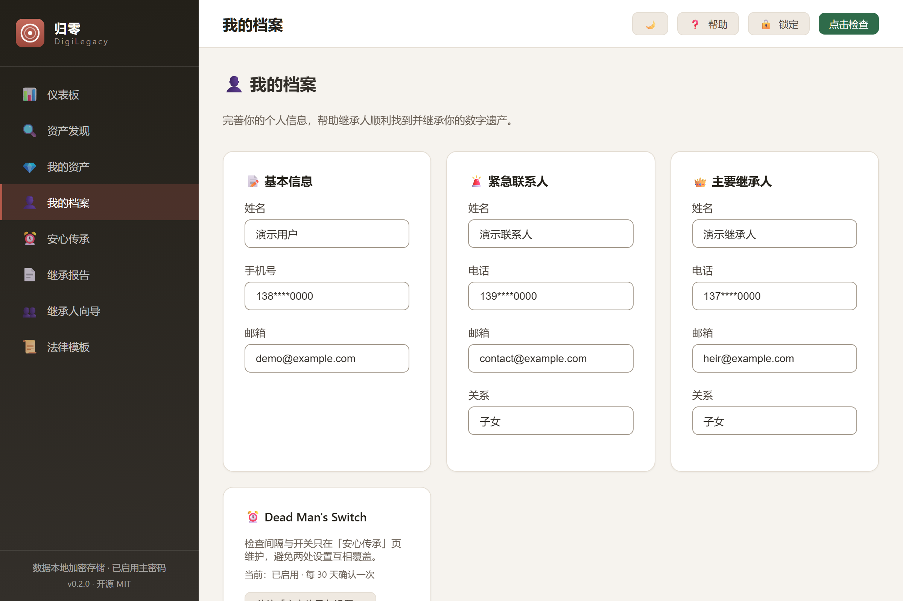

# DigiLegacy 归零 — Open-Source Digital Legacy & Inheritance Manager

**English** · [简体中文](README.zh-CN.md)

[](https://github.com/badhope/digilegacy/actions/workflows/ci.yml)
[](LICENSE)
[](#development--verification)
[](#get-started)
[](#privacy-model)
[](#privacy-model)

**Website: [badhope.github.io/digilegacy](https://badhope.github.io/digilegacy/) ([中文站](https://badhope.github.io/digilegacy/zh/))** · **[Live demo](https://badhope.github.io/digilegacy/demo/)** · [Screenshots](https://badhope.github.io/digilegacy/#screenshots)

> **Plan your digital legacy. Leave your family a toolkit, not a puzzle.**

DigiLegacy is a free, open-source, **local-first desktop application** for **digital legacy planning** and **digital inheritance management**. It helps you discover every online account you own, decide how each one should be handled, and produce a **ready-to-execute inheritance toolkit** for your family — with everything encrypted on your own device.

**Open source (MIT) · No servers · No telemetry · Not even the developers can read your data.**

### Topics

`digital-legacy` · `digital-inheritance` · `digital-assets` · `estate-planning` · `dead-mans-switch` · `local-first` · `privacy-first` · `zero-knowledge` · `aes-256-gcm` · `encrypted-vault` · `rust` · `tauri` · `vue3` · `sqlite` · `open-source` · `desktop-app`

---

## Table of contents

- [Why this exists](#why-this-exists)
- [Features](#features)
- [Screenshots](#screenshots)
- [Security model](#security-model)
- [Comparison](#comparison)
- [Get started](#get-started)
- [Architecture](#architecture)
- [Development & verification](#development--verification)
- [Data storage](#data-storage)
- [Privacy model](#privacy-model)
- [FAQ](#faq)
- [Mirrors](#mirrors)
- [License](#license)
- [简体中文说明](README.zh-CN.md)

---

## Why this exists

When someone dies, their family usually cannot find — or access — what they left online. Three problems stack on top of each other:

1. **Nobody knows what exists.** Payment balances, game assets, subscription credits, creator income — scattered across dozens of platforms. Even the owner cannot list them from memory.
2. **Nobody knows what is inheritable.** A wallet balance can be inherited; the account itself often cannot. Game accounts have case law supporting property rights. Rules differ per platform and live inside terms of service.
3. **Nobody knows how to claim it.** A deadlock: platforms ask for a notarized certificate; notaries need to know what the accounts contain; the family does not know. The estate simply goes dormant.

Existing tools each answer a fragment: Google and Apple cover only their own ecosystems; password managers hand over credentials, not inheritance rights; paper will services never touch the accounts themselves. **The full chain — discovery, registration, planning, documents, trigger, execution — has no incumbent.**

## Features

| # | Module | What it does |
|---|---|---|
| 1 | **Digital asset discovery** | Built-in policy database of **152 platforms across 16 categories**, plus a guided self-check questionnaire that surfaces accounts you have already forgotten; already-registered entries are de-duplicated automatically |
| 2 | **Classification & registration** | Every asset is classified as *property*, *personality* or *mixed*. Platform passwords are never stored — the app records *where* an account exists, not *how to break into it* |
| 3 | **Disposal planning** | Per asset: inherit by a named person · liquidate and distribute · memorialize · authorize viewing · delete permanently · donate · take no action |
| 4 | **Inheritance report & toolkit** | One-click HTML report plus a ZIP toolkit (report, asset list, summary, instructions). Open formats — readable without this application |
| 5 | **Dead man's switch** | Periodic check-in with a **three-stage confirmation chain** (remind you → notify your emergency contact → send inheritance instructions to your executor). Runs in the system tray, re-evaluating every 30 minutes; optional **zero-content** cloud heartbeat |
| 6 | **Heir guidance wizard** | Walks family members through each platform's procedure, required documents and transfer path |
| 7 | **Legal template library** | Six categories of legal document templates (will clause, inheritance declaration, authorization, affidavit, application, agreement) |
| 8 | **Encrypted vault & recovery key** | Field-level AES-256-GCM encryption, master password lock with idle auto-lock, one-time recovery key, encrypted backup export/import |
| 9 | **Onboarding & help centre** | First-run guided tour; built-in help explaining the encryption model and the **real** capability boundaries of reminders |
| 9b | **Light / dark theme** | Follow-system by default with a one-click toggle; every surface uses design tokens so both themes stay consistent. Honours `prefers-reduced-motion` and ships print styles |
| 10 | **Credential vault** | Optional encrypted storage of account credentials. Excluded from the **report and toolkit** exports; the **encrypted backup** carries the ciphertext so credentials survive a device migration (they stay unreadable without your master password) |
| 11 | **Search, sort & composition chart** | Full-text search across platform, account and notes; sort by recency / value / platform / disposal state; ECharts donut showing the property / personality / mixed split |
| 12 | **Interactive web demo** | A static build of the same UI running on mock data, deployed with the website — click through every screen without installing anything |

## Screenshots

| | |
|---|---|
|  |  |
| *Dashboard — stats, planning progress and asset composition* | *Guided discovery questionnaire* |
|  |  |
| *Registered assets with search, sort and disposal status* | *Asset detail with encrypted credential vault* |
|  |  |
| *Profile, encryption and backup* | *Dead man's switch & local reminders* |
|  |  |
| *Generated inheritance report* | *Heir guidance wizard* |
|  |  |
| *Legal template library* | *Dark theme (token-driven, WCAG AA contrast)* |

**Demo video:** [`docs/media/demo-walkthrough.mp4`](docs/media/demo-walkthrough.mp4) — a 32-second click-through of the full flow (discovery → registration → disposal → check-in → report → heir guide).

> The desktop interface is currently in Simplified Chinese (the primary target locale); an in-app English UI is on the roadmap and has not been started. This README, the [Chinese README](README.zh-CN.md), the website (EN + [中文](https://badhope.github.io/digilegacy/zh/)) and the browser demo are bilingual. All screens are also viewable on the [website](https://badhope.github.io/digilegacy/#screenshots).

## Security model

Digital legacy data is the most private data a person owns — it contains both property information and wishes about who may see what. The architecture removes the question rather than promising an answer:

| Layer | Implementation |
|---|---|
| **Field-level encryption** | Sensitive fields are encrypted with **AES-256-GCM** *before* they reach the database (`enc:v1:` prefixed ciphertext). The master key is derived with **PBKDF2-SHA256, 600,000 iterations** (100,000 for vaults created before v2; the salt is self-describing, so old vaults keep unlocking) |
| **Key lifetime** | The derived key lives only in memory. Locking the app (manually or after 10 minutes idle) zeroes and drops it; credential reads are refused at the decryption layer while locked |
| **Recovery** | A one-time **24-character recovery key** seals the master key, so forgetting the password is recoverable; the recovery key rotates automatically on every password change |
| **No server, no telemetry** | There is no backend. Apart from the optional heartbeat you configure yourself, the app makes no network requests — "open platform website" hands a URL to your system browser (http/https only) |
| **Zero-content heartbeat (optional, self-hosted)** | If you want reminders while the machine is off, the heartbeat sends **only a token**. You must point it at a server you run (`server/heartbeat-server.mjs` is a complete reference); configure it in **Profile → cloud heartbeat**. No default endpoint is shipped — the project does not operate a public server |
| **Exports** | Reports and toolkits are open HTML/JSON/ZIP and contain **no credentials**, stated explicitly in the generated toolkit instructions. The separate **backup file** does include credential *ciphertext* (never plaintext) so a restore keeps your vault intact |

**Honest limitations.** Local encryption protects data at rest; it cannot stop malware running as your user or someone who knows your master password. Credentials you choose to save live on the same machine — the same trade-off every password manager makes. Reports and toolkits are plain files: treat them like paper documents.

## Comparison

| Tool | Scope | What it leaves out |
|---|---|---|
| **DigiLegacy** | Discovery · registration · planning · documents · trigger · execution | — |
| Google Inactive Account Manager | Google accounts only | Any non-Google platform; no inventory; no planning workflow |
| Apple Digital Legacy | Apple ID access for a legacy contact | No inventory; no per-platform procedures |
| Meta memorialization | Facebook / Instagram | Passive marking only |
| 1Password / Bitwarden emergency access | Credential handover | Answers "who gets the password", not "can it be inherited, and how" |
| Offline will services / notary offices | Paper wills | No digital asset discovery; no platform guidance |

## Get started

### Use the app (Windows 10/11)

Download the installer from [Releases](https://github.com/badhope/digilegacy/releases). No account, no sign-up, no network connection required.

| Package | Size (v0.2.0, x64) | Notes |
|---|---|---|
| `DigiLegacy_0.2.0_x64-setup.exe` (NSIS) | ~3.7 MB | Recommended; per-user install, no admin required |
| `DigiLegacy_0.2.0_x64_zh-CN.msi` (WiX) | ~5.2 MB | For managed deployment / group policy |

```
Installer  : DigiLegacy_*_x64-setup.exe (ASCII file name; the window title still reads 归零 DigiLegacy)
Database   : %APPDATA%\com.digilegacy.app\digilegacy.db
```

On first launch a short guided tour explains each screen. The built-in help centre documents the encryption model and the true boundaries of the reminder chain.

### Build from source

```bash
git clone https://github.com/badhope/digilegacy.git
cd digilegacy

npm install
npm run tauri:dev        # desktop development mode
npm run tauri:build      # produce installers

npm run dev              # frontend only — browser preview at http://localhost:1420
npm run build:demo       # static demo build (mock backend, hash routing)
node scripts/demo-media.mjs   # regenerate docs/screenshots + demo video (needs `npm run dev` running)
cd src-tauri && cargo test
```

### Optional: self-hosted heartbeat server

```bash
cd digilegacy/server
# 1. register the token your client will send
cat > registrations.json <<'JSON'
{ "replace-with-a-long-random-token": { "grace_days": 21, "notify_webhook": "https://your-gateway.example/hook" } }
JSON
# 2. start with an admin token (required for /check)
HEARTBEAT_ADMIN_TOKEN="$(openssl rand -hex 24)" node heartbeat-server.mjs
```

Point the client at it in **Profile → cloud heartbeat** (endpoint + token, stored in the local database). Environment variables `DMS_HEARTBEAT_ENABLED` / `DMS_HEARTBEAT_TOKEN` / `DMS_HEARTBEAT_ENDPOINT` are still honoured as a fallback for headless deployments, but the in-app form takes precedence.

The reference server does three things: record the last heartbeat time per token, emit an alert payload when a token goes silent (default 21 days), and hand that payload to your scheduled job for delivery. **It never receives or stores user content.**

Hardening worth knowing before exposing it: `/check` requires `Authorization: Bearer $HEARTBEAT_ADMIN_TOKEN` and returns 503 when that variable is unset (fail closed rather than leaking every token); unregistered tokens are rejected with 403 unless you set `HEARTBEAT_ALLOW_ANY=1` for local experiments; bodies are capped at 4 KB; alert state is persisted and resets on the next heartbeat, so a restart neither repeats alerts nor suppresses the next silence. `node heartbeat-server.test.mjs` covers all of it.

```bash
# poll from cron / systemd timer
curl -sf -H "Authorization: Bearer $HEARTBEAT_ADMIN_TOKEN" http://127.0.0.1:8080/check
```

## Architecture

A deeper module-by-module breakdown, layering rules, and the encryption data flow are in [`docs/ARCHITECTURE.md`](docs/ARCHITECTURE.md).

```
Vue 3 + TypeScript + Pinia + Vue Router        frontend
        │  Tauri invoke (42 registered commands)
Tauri 2 (Rust)                                 desktop shell
        │
rusqlite (SQLite, bundled)                     local storage
aes-gcm · pbkdf2-sha2 · rand · base64          crypto layer
```

```
.
├── docs/                                  # project website (GitHub Pages)
├── digilegacy/
│   ├── src/                               # Vue frontend
│   │   ├── views/                         # 9 screens
│   │   ├── stores/                        # Pinia state
│   │   ├── api/                           # invoke wrapper + browser-preview mock
│   │   ├── components/                    # onboarding tour, help drawer
│   │   └── assets/main.css                # design tokens
│   ├── src-tauri/                         # Rust backend
│   │   ├── src/
│   │   │   ├── platform_data.rs           # 152-platform policy database
│   │   │   ├── db.rs                      # schema, queries, migrations
│   │   │   ├── commands.rs                # 41 commands + notify::evaluate_dms
│   │   │   ├── vault.rs                   # master password & field encryption
│   │   │   ├── recovery.rs                # one-time recovery key
│   │   │   ├── heartbeat.rs               # zero-content cloud heartbeat
│   │   │   ├── crypto.rs                  # AES-256-GCM primitives
│   │   │   └── notify.rs                  # dead man's switch chain
│   │   └── capabilities/                  # permission allowlist
│   ├── server/heartbeat-server.mjs        # reference heartbeat server (+ .test.mjs)
│   └── scripts/demo-media.mjs             # screenshot & walkthrough-video generator
└── LICENSE
```

## Development & verification

| Check | Command | Status |
|---|---|---|
| Rust unit + integration tests | `cargo test` (in `src-tauri/`) | **86 passing, 1 ignored** |
| Frontend unit tests | `npm test` (in `digilegacy/`) | **265 passing** |
| Frontend E2E | `npm run test:e2e` (in `digilegacy/`) | **37 passing** |
| Heartbeat server behaviour | `node server/heartbeat-server.test.mjs` | **9 assertions passing** |
| Frontend type check | `npx vue-tsc --noEmit` | passing |
| Production build | `npm run build` | passing |
| Coverage (statements/branches/functions/lines) | `npm run test:coverage` | **79.4 / 79.0 / 73.2 / 80.8** (gates 78/78/71/79) |

> `.github/workflows/ci.yml` runs on every push to `main` and on every pull request, in five jobs:
>
> 1. **前端** — `npm ci` → `vue-tsc --noEmit` → `npm run test:coverage`（含覆盖率门禁）→ `npm run build` → `npm audit`
> 2. **E2E** — `npm ci` → Playwright Chromium → `npx playwright test` → E2E 覆盖率报告（不阻断）
> 3. **Rust** — `cargo fmt --check` → `cargo clippy --all-targets -- -D warnings` → `cargo test --locked` → `cargo audit`
> 4. **心跳服务器** — `node --check` + `heartbeat-server.test.mjs`（9 项断言：鉴权、未注册令牌、413、健康探针）
> 5. **发布构建**（windows-latest）— `npm run tauri:build`，断言 MSI 与 NSIS 产物都存在并上传
>
> 本地等价校验用 `bash scripts/verify.sh`（会显式记录每个命令的退出码，避免 `cmd | tail` 吞掉失败）。
> 发布由 `.github/workflows/release.yml` 负责：推送 `v*` 标签时先校验三处版本号一致，再构建安装包并生成 SHA-256 校验和。

### Test coverage — what the numbers actually cover

Frontend coverage is tracked with thresholds in `vitest.config.ts` (statements 78 / branches 78 / functions 71 / lines 79), measured over the **whole** `src/**` tree (`coverage.include`) so that untested views count as 0% instead of vanishing from the report. Current measured unit coverage is 79.4% statements (79.0% branches, 73.2% functions, 80.8% lines). A separate Playwright E2E suite covers the view layer end-to-end (see below):

- **`src/api/mock.ts` is development-preview code only.** It is not in the production bundle (`npm run build` does not include it — verified by grepping `dist/`). Its 14 tests exercise the browser demo backend, not the shipped app. They are still useful as a regression net for the preview, but they must not be counted as product coverage.
- **The view layer** now has two layers of protection:
  - *Unit/render tests* for `App.vue`, `AssetsView`, `ProfileView`, `ReportView`, `DiscoverView`, `AssetDetailView` and `CollapseGroup`. All seven views are now covered: `DMSView` 97%, `ReportView` 88%, `DiscoverView` 86%, `AssetsView` 84%, `AssetDetailView` 76%, `ProfileView` 57%, plus `DashboardView` / `HeirGuideView` / `LegalTemplates` for their filter, grouping and preview logic.
  - *Playwright E2E* for the seven views that unit tests cannot reach: `DiscoverView`, `DMSView`, `DashboardView`, `ReportView`, `HeirGuideView`, `LegalTemplates` and `AssetDetailView`. The suite drives a real Chromium browser through the actual components, stores and router (only the IPC backend is the preview mock), covering the full asset-discovery chain, DMS check-in, report export, heir-guide tabs, legal-template preview and asset detail navigation.

  E2E does not feed the v8 coverage numbers above — it is a behavioural net, not a line-coverage instrument. Run it with `npm run test:e2e` (first time: `npx playwright install chromium`).

Four real defects were found by the newly added tests (all fixed):

1. `dashboard.saveUser` reported success on a rejected write (locked vault), so the UI said “saved” while nothing was stored.
2. `CollapseGroup`'s `defaultOpen` was swallowed by Vue's boolean prop coercion — the discovery page's platform groups rendered collapsed when they should be open.
3. The recovery flow cleared `recoveryUnlocked` on success, which hid the **new** recovery code along with the form: the old code was already invalidated, so the user could never copy the replacement.
4. The recovery screen had no submit button at all — only the Enter key worked, leaving mouse users stuck.

## Data storage

A single local file: `digilegacy.db` in the app data directory (`%APPDATA%\com.digilegacy.app` on Windows), holding eight tables:

`platforms` · `digital_assets` · `user_profile` · `check_in_log` · `dms_config` · `security_config` · `heartbeat_config` · `platform_overrides`

On first launch the database is created and seeded with the platform policy database; the platform table is **synchronised idempotently on every start**, so policy and URL corrections reach existing installations without touching user data. Older databases are migrated automatically (`credential_enc`, `recovery_seal`, `emergency_contact_email`, `heir_primary_email` columns), and the schema version is recorded in `PRAGMA user_version` (currently `2`).

`heartbeat_config` stores the optional cloud-heartbeat endpoint and token; `platform_overrides` stores user-imported policy patches, kept separate because the built-in platform table is rewritten on every start. Both are included in backups since format v2; importing an older v1 backup leaves your local copies untouched rather than wiping them.

## Privacy model

1. **Field-level encryption.** Account identifiers, credentials, profile fields and heir contact details are encrypted with AES-256-GCM before storage; the master key is derived with PBKDF2-SHA256 and held in memory only.
2. **Master-password lock.** Manual lock, or automatic after 10 minutes idle. While locked, credential decryption is refused at the Rust layer — the UI overlay is only the visible half.
3. **Credential vault.** Optional encrypted storage with copy-to-clipboard. Credentials never enter reports or toolkits; the encrypted backup stores them only as ciphertext, which stays unreadable without the master password.
4. **No server, no telemetry, no cloud sync.** External links are restricted to `http`/`https`.
5. Application permissions are narrowed to an allowlist in `src-tauri/capabilities/default.json`.

## FAQ

<details>
<summary><strong>Is it really free?</strong></summary>

Yes. The desktop application is MIT-licensed and permanently free — the entire source is open. Optional cloud conveniences (encrypted backup, assisted setup) are planned as paid services; the local app stays free.
</details>

<details>
<summary><strong>What happens to my data if the project stops being maintained?</strong></summary>

Nothing breaks. There is no server to switch off: your data is a local SQLite file, exports are open formats, and the code is public — anyone can fork and continue. That is precisely why the architecture was chosen this way.
</details>

<details>
<summary><strong>Does it store my passwords?</strong></summary>

It never stores platform passwords in plaintext. If you choose to save credentials, they are encrypted with your master password on your machine and are deliberately excluded from every export.
</details>

<details>
<summary><strong>Can it automatically detect all my accounts?</strong></summary>

No — and any tool claiming that would either be lying or require your credentials. DigiLegacy performs **guided discovery**: it knows 152 mainstream platforms and asks questions that help you remember, then you confirm. The final list is always yours.
</details>

<details>
<summary><strong>Do reminders work when the app is closed?</strong></summary>

With the tray resident (default) the app re-evaluates every 30 minutes while running and can start with Windows. For reminders while the machine is off, enable the optional zero-content cloud heartbeat — the server only ever sees a token.
</details>

<details>
<summary><strong>Why a policy database for Chinese platforms?</strong></summary>

Because that is where platform inheritance rules are most opaque and least documented — the database covers 152 platforms used in mainland China (WeChat, Alipay, Taobao, Bilibili, Steam and more), the highest-value entries carry their source citation in `data_source`. The architecture itself is not region-bound.
</details>

<details>
<summary><strong>How can I contribute?</strong></summary>

Issues and pull requests are welcome — especially policy corrections (add the official policy URL and a source citation) and translations. The database is plain Rust data and easy to extend.
</details>

## Mirrors

| Platform | Repository | Website |
|---|---|---|
| GitHub · badhope | [github.com/badhope/digilegacy](https://github.com/badhope/digilegacy) | [badhope.github.io/digilegacy](https://badhope.github.io/digilegacy/) |
| GitHub · x33834 | [github.com/x33834/digilegacy](https://github.com/x33834/digilegacy) | [x33834.github.io/digilegacy](https://x33834.github.io/digilegacy/) |
| GitHub · Morningstar202604 | [github.com/Morningstar202604/digilegacy](https://github.com/Morningstar202604/digilegacy) | [morningstar202604.github.io/digilegacy](https://morningstar202604.github.io/digilegacy/) |
| Gitee · badhope | [gitee.com/badhope/digilegacy](https://gitee.com/badhope/digilegacy) | — |
| GitCode · badhope | [gitcode.com/badhope/digilegacy](https://gitcode.com/badhope/digilegacy) | — |

## License

MIT — see [LICENSE](LICENSE).

---

## 简体中文

完整中文文档见 [README.zh-CN.md](README.zh-CN.md)，中文官网见 [badhope.github.io/digilegacy/zh](https://badhope.github.io/digilegacy/zh/)。
